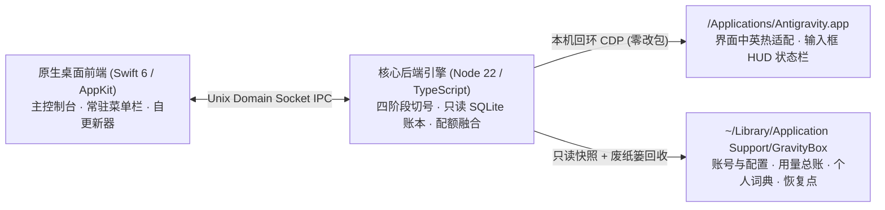

<div align="center">
  <a href="https://github.com/Enzoo404/gravitybox">
    
  </a>

  <h1>GravityBox</h1>

  <p>
    <strong>专为 Apple Silicon Mac 打造的 Google Antigravity 原生增强工具箱</strong><br />
    不改官方安装包、不破系统签名 —— 一键切换中文界面 · 输入框下实时看 Token 与上下文 · 看清 5 小时/每周真实配额 · 多账号安全切换 · 无损清理缓存
  </p>

  <p>
    <a href="https://github.com/Enzoo404/gravitybox/releases/latest"></a>
    <a href="https://github.com/Enzoo404/gravitybox/actions/workflows/ci.yml"></a>
    
    <a href="./LICENSE"></a>
  </p>

  <p>
    <b>简体中文</b> · <a href="./README_EN.md">English</a>
  </p>

  <p>
    <a href="#-gravitybox-是干什么的">它是干什么的</a> ·
    <a href="#-3-分钟快速上手">怎么用</a> ·
    <a href="#-对话状态栏-hud-完全图解">HUD 状态栏图解</a> ·
    <a href="#-全界面与每一个选项详解">全部选项说明</a> ·
    <a href="#-界面实机预览">界面预览</a> ·
    <a href="#-安装与无损升级">安装与升级</a> ·
    <a href="#-安全与隐私边界">安全边界</a> ·
    <a href="#-架构与源码构建">源码构建</a>
  </p>
</div>

<br />

<div align="center">
  <picture>
    <source media="(prefers-color-scheme: dark)" srcset="assets/screenshots/hero-dark.png" />
    
  </picture>
  <sub><em>纯正 macOS Swift AppKit 原生主控制台与菜单栏快捷面板（自动跟随系统浅色 / 深色模式）</em></sub>
</div>

---

## ✨ GravityBox 是干什么的？

如果你日常在 Mac 上使用 Google **Antigravity** 写代码，大概率遇到过这些烦恼：全英文界面不够顺手、聊着聊着突然限流却分不清是 5 小时还是周额度用完了、完全不知道当前对话烧了多少 Token 或上下文快满了没、切换多个 Google 账号既麻烦又怕把本地状态搞坏。

**GravityBox**（当前版本 `GravityBox v1.2.0`）就是为了解决这些问题而生的**轻量级原生桌面伴侣**。它不修改 Antigravity 里的任何一行官方文件，打开即用：

| 日常痛点 | GravityBox 帮你做什么 |
| :--- | :--- |
| **全英文界面阅读费力，打汉化补丁又会破坏官方签名、每次更新都失效** | **零改包实时中英切换**：在运行期动态把 Antigravity 菜单、设置、侧栏变成地道中文（已覆盖 `2.23.0` ~ `2.33.0`），不碰代码、聊天记录与终端输出；GravityBox 自身也支持 **跟随系统 / 简体中文 / English** 无感热切换。 |
| **盲聊盲跑，不知道这轮跑了多久、生成多快、上下文还剩多少空间** | **输入框下嵌对话状态栏 (HUD)**：直接在每个聊天框正下方显示轮次、耗时、吐字速度、累计 Token、缓存省钱比例与上下文水位，悬停或点击即可向上弹出完整账单。 |
| **配额显示笼统，常把“每周总额度”误当成“5 小时滚动额度”** | **双周期配额拆开看**：把 Gemini、Claude/GPT 的 **5 小时窗口** 与 **每周窗口**（以及 Pro 独立计算的 `Gemini 4 Argon` 等子模型）逐条列清，精确显示几小时几分钟后重置。 |
| **手里有多个账号，反复退出重登太折腾，还怕切坏工作区** | **多账号管家与安全切换**：支持保存多个账号、额度见底时智能推荐备用号；退出 Antigravity 后一键安全切换，万一中途异常自动原位回滚，绝不后台强杀进程。 |
| **用久了占用好几个 GB 磁盘空间，手动删缓存怕误删聊天记录和登录态** | **可撤回的无损存储瘦身**：自动锁死登录凭据与聊天正文，只清理无用运行缓存与超期后台日志；清理文件统一移入**系统废纸篓**并保留快照，随时可一键还原。 |

---

## 🚀 3 分钟快速上手

### 第一步：下载并安装
1. 前往 [GitHub Releases](https://github.com/Enzoo404/gravitybox/releases/latest) 下载最新的 `GravityBox-<version>-arm64.dmg`（安装包已内置全部运行环境，**无需安装 Node.js 或任何外部依赖**）。
2. 双击打开 DMG，将 **GravityBox.app** 拖入 **Applications（应用程序）** 文件夹。
3. 由于开源免费软件未经过 Apple 付费公证，首次打开前请在终端执行一行放行命令（只需执行一次）：
   ```bash
   xattr -cr /Applications/GravityBox.app
   ```
   *(不想用终端也可以：首次双击若弹出拦截提示，前往「系统设置 → 隐私与安全性」点击底部的 **「仍要打开」** 即可。)*

### 第二步：启动即自动连接
打开 **GravityBox**，再通过侧栏/菜单栏 **「打开 Antigravity」**（或正常启动官方正式版 **Antigravity**）。无需任何配置，GravityBox 会自动识别并连接 Antigravity 窗口：
- 若你的系统是中文，Antigravity 界面会自动切换为中文；
- 每个对话输入框的正下方，会自动出现一条精致的三联状态栏（HUD）；
- 若 Antigravity 是在外部启动且未开启调试端口（`2.33.0` 起默认关闭），主界面与菜单栏会温和提示 **「未开启调试端口」**，确认后即可安全重启并重连，绝不后台强杀进程。

### 第三步：日常怎么配合最顺手？
- **写代码时 → 低头看输入框下方 HUD**：随时掌握当前对话速度和上下文水位；鼠标悬停查看详情，**点击任意胶囊可固定弹窗**（按 `Esc` 或点击空白处收起）。
- **随手查额度 → 点屏幕右上角菜单栏图标**：不用切出全屏窗口，点一下菜单栏里的 GravityBox 图标就能看今日用量、剩余配额和快速切号。
- **细管账号与空间 → 打开主控制台**：点击菜单栏面板右下角「打开主界面 ↗」，使用完整的 **总览 · 账号 · 用量 · 设置 · 关于** 五页工作台。

---

## 📊 对话状态栏 (HUD) 完全图解

HUD 静静挂载在每一个 Antigravity 对话输入框正下方（支持分栏多开与浅色/深色主题），既不挡视线，也不会抢走打字焦点。

<div align="center">
  <picture>
    <source media="(prefers-color-scheme: dark)" srcset="assets/screenshots/hud-dark.png" />
    
  </picture>
</div>

### 一、常驻状态栏怎么看？（输入框下方的三枚胶囊）

平时不用点开，扫一眼这三枚胶囊就能掌握全局：

<div align="center">
  <picture>
    <source media="(prefers-color-scheme: dark)" srcset="assets/screenshots/hud-capsules-dark.png" />
    
  </picture>
</div>

```text
[ ● 3 轮 · 本轮 18s · 90 tok/s · 2 ]  │  [ ✦ 58.6M tok · 缓存命中 97% ]  │  [ ②  ━━━░░  64% ]
  └────── 胶囊 1：对话、速度与子智能体 ──────┘     └──── 胶囊 2：Token 与缓存 ────┘     └── 胶囊 3：压缩与上下文水位 ─┘
```

| 位置 | 你看到的内容 | 代表什么意思？ |
| :--- | :--- | :--- |
| **胶囊 1 左侧圆点** | ⚪ 灰 / 🔵 实心蓝 / 💠 呼吸蓝 | **当前工作状态灯**：<br>• **灰色**：空闲等待你发消息；或对话暂停/卡住（如等待你批准操作，或前台模型思考与本地工具均未处于实际运行中；若仅后台子智能体在运行而当前主对话前台已空闲，圆点也保持灰色）<br>• **实心蓝点**：前台 AI 模型正在思考或流式输出文字<br>• **呼吸闪烁蓝点**：前台 Agent 正在调用本地工具（读写文件、跑终端命令、搜代码等） |
| **胶囊 1 文字** | `3 轮 · 本轮 18s · 90 tok/s` | • **`3 轮`**：当前主对话里你一共发了几次提问<br>• **`本轮 18s`**：当前这一轮任务已经运行了多少秒（实时走表）<br>• **`90 tok/s`**：本对话平均每秒生成多少 Token（首轮尚无完成样本时显示 `计算中...`）<br>• **分支图标 + 数字（如 `2`）** *(按需出现)*：后台有并行子智能体正在干活时会动态显示数量 |
| **胶囊 2 文字** | `✦ 58.6M tok · 缓存命中 97%` | • **`58.6M tok`**：这场对话（包含所有关联子智能体）累计消耗的总 Token 数<br>• **`缓存命中 97%`**：所有输入中有多少比例直接复用了上下文缓存（越高越快、越省额度） |
| **胶囊 3 左侧圆标** | 无 / 🔵 `1` / 🟠 `2` / 🔴 `3+` | **上下文自动压缩徽章**：<br>• **默认隐藏**：上下文还没满，未发生过压缩<br>• **蓝标 `1`**：对话较长，已触发 1 次自动压缩（Checkpoint）<br>• **橙标 `2`**：已压缩 2 次，历史细节开始浓缩<br>• **红标 `3` 及以上**：已多次压缩，若发现 AI 开始遗忘早期细节，建议新开一个对话 |
| **胶囊 3 进度条与百分比** | `━━━░░ 64%`（或 `~64%`） | **当前上下文水位**：最新一步请求占用了当前模型最大上下文窗口的百分比（随水位从浅天蓝渐深至钴蓝；若模型未返回精确容量上限，百分比前会带 `~` 表示按参考容量估算）。多模型切换或规划/执行协作时，胶囊内还会标出当前模型简称。 |

---

### 二、向上展开的 3 张详情卡片，每一项分别是什么意思？

把鼠标悬停（或点击固定）在对应胶囊上，会向上弹出对应的明细卡片：

#### 1. 「对话统计」卡片（展开第 1 枚胶囊）
> 卡片右上角显示 **`{X} 轮 {Y} 步`**：代表你发起了 `X` 轮对话，AI（含关联子智能体）在底层一共执行了 `Y` 个思考与工具步骤。

<div align="center">
  <picture>
    <source media="(prefers-color-scheme: dark)" srcset="assets/screenshots/hud-card-session-dark.png" />
    
  </picture>
</div>

| 字段名称 | 通俗解释 |
| :--- | :--- |
| **模型用时** | 整场对话从开始到现在，AI 模型花在“思考 + 生成回复”上的累计时间。 |
| **工具调用用时** | 整场对话里，Agent 花在“读文件、改代码、跑终端命令”等工具执行上的累计时间（多工具并行执行时已自动合并重叠时间，不会虚高）。 |
| **首 token 平均（TTFT）** | 平均每次向模型发请求后，等到它吐出第一个字需要几秒（越短说明云端响应越快）。 |
| **输出速度（TPS）** | 整场对话已完成模型步的平均吐字速度（`总输出 Token ÷ 包含等待与思考的生成耗时`）。 |
| **本轮用时** *(虚线下方)* | 你刚刚发出的这一轮，从按下发送到此刻一共耗时多久。 |
| **最近一步 TTFT** | 刚刚跑完的最后一次模型调用，首字响应等了几秒（方便对比是不是突然变卡了）。 |
| **最近一步 TPS** | 刚刚跑完的最后一次模型调用，单步输出速度是多少 `tok/s`。 |
| **子智能体状态** *(有子任务时显示)* | 显示当前有几个子智能体正在运行，或本场对话一共派发过几个子智能体、累计跑了多少步。 |

#### 2. 「Token 用量」卡片（展开第 2 枚胶囊）
> 卡片右上角显示本对话累计总 Token（`K` = 千，`M` = 百万，`B` = 十亿）。

<div align="center">
  <picture>
    <source media="(prefers-color-scheme: dark)" srcset="assets/screenshots/hud-card-tokens-dark.png" />
    
  </picture>
</div>

| 字段名称 | 通俗解释 |
| :--- | :--- |
| **缓存命中** | 累计所有输入里，直接命中历史缓存而无需重新计算的百分比（如 `96.7%`）。 |
| **未缓存输入** | 没走缓存、实打实新发给模型的输入 Token（比如你刚输入的问题、刚读入的新文件内容）。 |
| **缓存读取** | 直接从云端缓存池里复用的上文 Token（不仅速度快，API 计费通常也只有普通输入的 10%～25%）。 |
| **缓存写入** *(有写入时显示)* | 本对话新建立并写入缓存池的 Token 数量。 |
| **输出** | 模型累计生成的所有输出 Token 总和（已包含内部思考和最终展示给你的文字）。 |
| **思维链 / 回复** *(模型支持拆分时显示)* | 把上面的「输出」拆成两部分看：**左边是内部思考（思维链）Token**，**右边是最终回复正文 Token**，一眼看出模型是不是“想太多、写太少”。 |
| **估算费用** *(虚线下方)* | 按每一步调用的模型与当时生效的官方 API 公开单价，折算出的**等效美元花费**（如 `~$0.18`；若包含刚上线、暂未公开单价的新模型，会标为 `≥ $0.18`）。*注：订阅制用户实际扣的是套餐额度，此项帮你直观衡量消耗量级。* |
| **缓存节省** | 如果没有缓存命中、每次都按全价重发所有上文，原本要多花多少钱——也就是缓存机制帮你省下的等效美元金额。 |

#### 3. 「当前上下文」卡片（展开第 3 枚胶囊）
> 卡片右上角显示 **`已用 Token / 模型最大容量`**（如 `128K / 200K`），下方配有一条双色构成进度条。

<div align="center">
  <picture>
    <source media="(prefers-color-scheme: dark)" srcset="assets/screenshots/hud-card-context-dark.png" />
    
  </picture>
</div>

| 字段名称 | 通俗解释 |
| :--- | :--- |
| **缓存复用上下文** *(深蓝圆点)* | 最新这一次请求里，直接复用之前对话记忆的 Token 数量（对应进度条深蓝色部分）。 |
| **本步新增输入** *(天蓝圆点)* | 最新这一次请求里，新塞进上下文的内容，包括新工具返回结果与本步输入（对应进度条天蓝色部分）。 |
| **本步生成输出** | 最新这一次请求里，模型刚刚生成的回复 Token（单独统计，到下一轮才会变成历史上下文）。 |
| **对话历史峰值 / 当前模型峰值** | 这场对话聊到现在，单次上下文最高曾涨到多少 Token；如果触发过自动压缩，末尾会注明 `(已压缩 X 次)`。 |
| **当前模型** | 当前上下文统计所对应的底层模型名称。 |
| **Orchestrator 上下文 / 曾用模型上下文** *(多模型时显示)* | 当你在同一对话中途换过模型，或触发了 **规划（Planner）+ 执行（Executor）** 双模型协作时，这里会分阶段单独列出每个模型的上下文水位与压缩次数。 |

---

## 🧭 全界面与每一个选项详解

除了输入框下方的 HUD，GravityBox 还提供**主控制台（5 个页面）**与**顶部菜单栏快捷面板**。下面是每一个开关、按钮和配置项的具体作用：

### 1. 设置页（`设置`）—— 7 个核心选项逐一说明

| 分组 | 选项名称 | 可选值 / 控件 | 它是干什么的？怎么选最合适？ |
| :--- | :--- | :--- | :--- |
| **Antigravity 增强** | **显示语言** | `跟随系统`（默认）<br>`简体中文`<br>`English` | **一键统管两边语言**：既切换 GravityBox 自己的界面语言，也同时控制是否把 Antigravity 界面翻译为中文。选 `English` 时，GravityBox 变为英文，同时 Antigravity 立即恢复官方原版英文界面，全程无需重启。 |
| **Antigravity 增强** | **对话状态栏** | 开关（默认 `开`） | 控制是否在 Antigravity 输入框下方挂载 HUD 状态栏。**它与语言相互独立**——即使你把语言设为 `English` 使用原版英文界面，也可以单独开着英文 HUD 查看实时速率与上下文。 |
| **配额与计价** | **配额刷新间隔** | `手动刷新`（默认）<br>`每 5 / 10 / 15 / 30 / 60 分钟` | 控制后台每隔多久自动拉取一次已保存账号的剩余配额。单账号用户保持 `手动刷新` 即可；多账号高频轮换建议设为 `每 10 分钟` 或 `每 15 分钟`。 |
| **配额与计价** | **自动更新价格基准** | `立即检查` 按钮 + 开关（默认 `关`） | 开启后每 24 小时自动从 GitHub / jsDelivr 同步一次最新公开模型单价表，无需等软件发版就能给新模型算准费用。<br>点击 **「立即检查」** 会弹出 **价格基准明细表**，可查看所有在用/已下架模型的输入、缓存读/写、输出费率与官方来源链接，自动按模型家族折叠归并尚待公开定价的新模型变体，并补齐历史未计价记录。 |
| **系统与存储** | **登录时启动** | 开关（默认 `关`） | 开启后，每次登录 macOS 时自动启动 GravityBox 并在右上角菜单栏静默待命。 |
| **系统与存储** | **跟随 Antigravity 启停** | 开关（默认 `关`） | 开启后，打开 Antigravity 时自动拉起 GravityBox，关闭 Antigravity 时自动一并退出——适合不喜欢后台常驻图标的用户。 |
| **系统与存储** | **存储与维护** | 状态徽章 + `管理存储…` 按钮 | 自动评估本机缓存体积（显示 `可释放 XX MB` 或 `状态良好`），点击打开安全清理面板（详见下方第 5 节）。 |

---

### 2. 总览页（`总览`）—— 一屏看清配额与今日消耗

- **当前账号配额卡片**：展示当前激活账号、订阅等级徽标（`PRO` / `ULTRA` / `FREE`）及各模型池的剩余进度条与重置倒计时：
  - **`Gemini · 5 小时` vs `Gemini · 每周`**：分别代表短周期 5 小时滚动限额与 7 天总限额，哪条先见底都会导致限流，拆开展示一目了然。
  - **`Claude/GPT · 5 小时` & `每周`**：Claude 与 GPT 系列共享模型池的双周期剩余配额。
  - **独立高阶模型条（如 `Gemini 4 Argon · 每周`）**：当你的套餐包含独立核算周期的高阶模型时自动单独列出；无权限或接口未返回时也会如实标注，绝不用虚假的 `100%` 误导你。
- **今日核心指标三联卡**：分别展示 **今日 Token 用量**、**今日费用估算**（存在未公开定价模型时独立悬挂 **「部分计价」** 徽章，不遮挡主金额数字）、**今日请求数**，每张卡底部同时附带本机历史累计总量。
- **今日时段消耗 & 今日活跃模型**：左边柱状图展示今天 `00时 ~ 23时` 每个小时的消耗分布与峰值时段；右边列出今天调用最多的主力模型、请求次数与费用占比。

---

### 3. 账号页（`账号`）—— 多账号管理与「智能切换」规则

- **添加账号…**：
  - **保存当前账号**（零配置）：一键把当前 Antigravity 正在登录使用的账号保存到列表中；如需添加多个账号，只需先在 Antigravity 中切换登录后再导入，随后即可一键安全切号。
- **收起配额 / 展开配额**：账号较多时，点击右上角「收起配额」可将每张大卡片折叠成一行紧凑胶囊摘要（如 `Gemini 91%`、`Claude/GPT 0%`）。
- **智能切换（开关 + `配置…` 按钮）**：
  开启后，GravityBox 会实时比对各账号配额，在当前账号额度偏低时为你标出 **`推荐备用`** 候选号（**安全铁律：绝不后台自动强杀 Antigravity，所有切换均需你手动点击确认**）。点击 **「配置…」** 可自定义 4 项规则：

  | 智能切换配置项 | 作用说明 |
  | :--- | :--- |
  | **推荐排序方式** | • **`配额充裕优先`**（默认）：优先推荐高阶订阅（Ultra > Pro），同等级下谁剩余百分比高推荐谁。<br>• **`按顺序轮询`**：在所有额度达标的备用号之间按列表顺序轮流推荐。 |
  | **监测模型范围** | 选择用哪个配额池判断是否该换号（会根据你当前账号套餐自动适配说明）：例如盯住 **主力共享池（Gemini + Claude/GPT）**、**Gemini 全系（含独立 Argon 周配额）**、**仅基础 Gemini 池** 或 **仅 Claude/GPT 池**。 |
  | **触发切换阈值** | 默认 `10%`（可设 `1%–98%`）。当监测的模型配额 **≤ 此百分比** 时，发出换号提醒。 |
  | **候选准入下限** | 默认 `30%`（可设 `2%–100%`，必须大于触发阈值）。备用账号剩余配额 **≥ 此百分比** 才会进入推荐名单，防止切过去立刻又没额度。 |

- **安全切换与一键反悔**：切换前自动检查 Antigravity 是否已安全退出，并通过“备份快照 → 同步凭据 → 校验状态”执行切换；中途任何一步失败都会自动恢复原状。如果上次切号意外中断，页面顶部会出现醒目的 **「撤销并恢复原账号」** 按钮。

---

### 4. 用量页（`用量`）—— 历史账单、请求明细与导出

- **四档时间范围**（`今日` / `近 7 天` / `近 30 天` / `全部`）：后台通过只读 SQLite 工作线程分批扫描本地对话库，不卡顿 IDE，随时切换查看不同周期的 Token 汇总与柱状趋势。
- **API 费用估算环图**：按模型展示等效美元账单与花费占比，谁是“吞金兽”一眼看穿。
- **请求与缓存 + `请求明细…`**：展示请求总数、单次平均 Token 与整体缓存命中率；点击 **「请求明细…」** 可打开独立检索窗口，支持**按模型名搜索**、分页翻阅每一条请求的精确时间与输入/缓存读/缓存写/输出明细。
- **导出…**：支持把汇总统计或逐条请求记录导出为本地 JSON 文件。

---

### 5. 存储与维护弹窗（`设置 → 管理存储…`）—— 怎么安全瘦身？

弹窗顶部的三色比例条会把 Antigravity 本地文件清晰划分为 **运行缓存（蓝）**、**早期日志（橙）** 和 **核心数据（灰，白名单锁死永不触碰）**：

| 清理项 / 按钮 | 默认状态 | 清理后会发生什么？安全吗？ |
| :--- | :--- | :--- |
| **应用运行缓存** | 默认开启 | 清理临时网页缓存、V8/GPU 着色器编译缓存与崩溃转储残留。**100% 无副作用**，下次打开应用会自动按需重建。 |
| **早期后台运行日志** | 默认关闭（可按需打开，可选 `7 天前` / `30 天前` / `全部非活跃`） | 只清理老旧非活跃对话的后台步骤日志、冗余大体积转录副本和已完结的旧子智能体轨迹库（移动前自动将 Token 用量与账单永久归档至总账）。**你的所有聊天记录正文、代码与账号登录态完好无损。** |
| **一键清理** | 主操作按钮 | 若 Antigravity 已关闭则直接清理；若正在运行，会先征得你确认后优雅重启完成清理。所有被清理文件均暂存至回收区并移入系统 **废纸篓**，绝不直接永久抹除。 |
| **撤回上次清理** | 清理后随时可用 | 清理完后悔了？点一下即可将上次移走的文件**原位无损还原**；也可点「在访达中查看」直接检查快照目录。 |

---

### 6. 常驻菜单栏面板 & 关于页（`关于`）

- **常驻菜单栏面板**（点击屏幕顶部菜单栏图标）：
  - **「用量」页签**：浓缩展示四宫格核心数据（Token、请求数、费用估算、缓存命中率）、支持一键切换 **`Token` / `请求`** 维度的趋势柱状图，以及各模型用量排行。
  - **「配额」页签**：免开大窗口，快速扫一眼当前账号所有模型池的 5 小时与每周进度条。
  - **「账号」页签**：展开查看所有已保存账号的配额，直接点击即可发起账号切换。
  - **右上角 `···` 快捷菜单**：不用进设置页，直接在这里就能切换 **显示语言**、开关 **对话状态栏**、打开设置（`⌘,`）或退出（`⌘Q`）。
- **关于页（`关于`）**：
  - 查看当前版本号、当前连接的官方 Antigravity 版本号，或点击 **「在访达中显示」** 直接打开数据目录（`~/Library/Application Support/GravityBox`）。
  - **检查更新 / 自动检查更新**：默认关闭后台联网检查，保持零打扰；开启「自动检查更新」后，发现新版本也只会在后台静默下载并通过 SHA-256 完整性校验，随后在主窗口左下角温和提示 **「安装更新」**，由你决定何时重启升级。

---

## 🖼 界面实机预览

> 所有界面均采用纯正 macOS Swift AppKit 原生构建（零 Web 套壳、零 SwiftUI 兼容层开销）；下方截图会跟随你的系统或浏览器自动切换浅色与深色模式。

<table>
  <tr>
    <td width="50%" align="center">
      <b>主控制台 · 总览</b><br /><br />
      <picture>
        <source media="(prefers-color-scheme: dark)" srcset="assets/screenshots/dark-overview.png" />
        
      </picture>
    </td>
    <td width="50%" align="center">
      <b>主控制台 · 账号管理</b><br /><br />
      <picture>
        <source media="(prefers-color-scheme: dark)" srcset="assets/screenshots/dark-accounts.png" />
        
      </picture>
    </td>
  </tr>
  <tr>
    <td width="50%" align="center">
      <b>主控制台 · 用量与费用</b><br /><br />
      <picture>
        <source media="(prefers-color-scheme: dark)" srcset="assets/screenshots/dark-usage.png" />
        
      </picture>
    </td>
    <td width="50%" align="center">
      <b>主控制台 · 设置</b><br /><br />
      <picture>
        <source media="(prefers-color-scheme: dark)" srcset="assets/screenshots/dark-settings.png" />
        
      </picture>
    </td>
  </tr>
</table>

<details>
<summary><b>点击展开更多实机截图：常驻菜单栏三页签、存储与维护弹窗、关于页</b></summary>
<br />
<table>
  <tr>
    <td width="33.3%" align="center">
      <b>菜单栏 · 用量</b><br /><br />
      <picture>
        <source media="(prefers-color-scheme: dark)" srcset="assets/screenshots/dark-menubar.png" />
        
      </picture>
    </td>
    <td width="33.3%" align="center">
      <b>菜单栏 · 配额</b><br /><br />
      <picture>
        <source media="(prefers-color-scheme: dark)" srcset="assets/screenshots/dark-menubar-quota.png" />
        
      </picture>
    </td>
    <td width="33.3%" align="center">
      <b>菜单栏 · 账号</b><br /><br />
      <picture>
        <source media="(prefers-color-scheme: dark)" srcset="assets/screenshots/dark-menubar-accounts.png" />
        
      </picture>
    </td>
  </tr>
  <tr>
    <td colspan="2" align="center">
      <b>存储与维护（安全瘦身与一键撤回）</b><br /><br />
      <picture>
        <source media="(prefers-color-scheme: dark)" srcset="assets/screenshots/dark-maintenance.png" />
        
      </picture>
    </td>
    <td align="center">
      <b>关于与更新页</b><br /><br />
      <picture>
        <source media="(prefers-color-scheme: dark)" srcset="assets/screenshots/dark-about.png" />
        
      </picture>
    </td>
  </tr>
</table>
</details>

---

## 📦 安装与无损升级

### 运行环境要求
- **操作系统**：macOS 14 (Sonoma) 或 macOS 15+ (Sequoia)
- **芯片架构**：Apple Silicon (`arm64`，M 系列全系芯片支持)
- **目标应用**：官方正式版 `/Applications/Antigravity.app`（已完整验证适配 `2.23.0` ~ `2.33.0`，*不支持也不干扰 Insiders 预览版*）
- **外部依赖**：**零依赖** —— `.app` 内已自带独立 Node 22 运行时与原生宿主程序

### 校验与安装完整步骤

1. 从 [GitHub Releases](https://github.com/Enzoo404/gravitybox/releases/latest) 下载 `GravityBox-<version>-arm64.dmg` 及同名 `.sha256` 校验文件。
2. *(可选)* 在终端核对安装包 SHA-256 指纹：
   ```bash
   shasum -a 256 -c GravityBox-<version>-arm64.dmg.sha256
   ```
3. 双击挂载 DMG，将 **GravityBox.app** 拖入 `/Applications`。
4. 首次启动前清除 macOS 隔离标记：
   ```bash
   xattr -cr /Applications/GravityBox.app
   ```

### 如何从旧版本升级？
- **直接拖入覆盖即可**：退出旧版 GravityBox，将新版拖进 `/Applications` 替换原应用（或在「关于」页直接点击检查更新一键升级）。
- **数据 100% 保留**：你保存的所有账号、自定义词典、历史用量总账和清理恢复点均独立存放在 `~/Library/Application Support/GravityBox`，覆盖升级不会丢失任何个人数据。
- **旧配置自动迁移**：若 `v1.0.5` 及更早版本曾配置过 `applicationChannel=insiders`，首次启动新版时会自动先备份原配置并平滑切换至正式版模式。

<details>
<summary><b>进阶可选：为备用账号配置后台静默刷新配额凭据</b></summary>
<br />

如果你只需要添加/切换多个账号、查看当前账号配额、使用 HUD 状态栏、统计历史费用与界面汉化，**完全不需要配置这一项**（只需在 Antigravity 中切换登录后点「保存当前账号」导入即可）。

只有当你希望备用账号的 Token 过期后仍能在**后台自动静默续期并刷新云端配额**时，才需要在 `~/Library/Application Support/GravityBox/.env` 中配置兼容的 OAuth 客户端凭据：

```bash
GRAVITYBOX_GOOGLE_CLIENT_ID="your-client-id.apps.googleusercontent.com"
GRAVITYBOX_GOOGLE_CLIENT_SECRET="your-client-secret"
```

</details>

---

## 🔒 安全与隐私边界

| 安全承诺 | 实际工程机制 |
| :--- | :--- |
| **零隐私收割、零遥测** | 无任何第三方统计 SDK、无崩溃上报、无暗中联网行为；自动检查更新与自动同步价格默认均为关闭状态。 |
| **绝不触碰官方安装包** | 通过本机回环（`127.0.0.1`）CDP 隔离世界运行，绝不解包、不改写 `app.asar`、不重签名 `/Applications/Antigravity.app`。 |
| **聊天与代码绝对隔离** | 编辑器草稿、历史对话正文、代码块、终端输出、文件名与工作区路径均受严格选择器白名单保护，绝不篡改或上传。 |
| **纯本地权限隔离存储** | 所有配置、钥匙串凭据索引、SQLite 账本与快照均仅保存在本机 `~/Library/Application Support/GravityBox`（严格 `0700` / `0600` 权限）。 |

---

## 🛠 架构与源码构建



### 从源码编译与运行开发门禁

> 源码构建需本机安装 Xcode Command Line Tools 与 Node.js `>=22.15.0 <23`。

```bash
git clone https://github.com/Enzoo404/gravitybox.git
cd gravitybox
npm ci

# 日常构建、同步价格表并运行核心单元/集成测试
npm test

# 运行原生 Swift AppKit 编译与界面排版检查
npm run check:swift

# 运行完整发版门禁（TS 编译 + 全量单测 + 无头浏览器回归 + Swift 编译 + 多版本词典门禁）
npm run verify

# 本地打包 Apple Silicon 原生 .app 与 .dmg 安装镜像
npm run package:mac
```

<details>
<summary><b>查看仓库目录结构说明</b></summary>

```text
gravitybox/
├── native/          # Swift 6 / AppKit 原生主控制台、菜单栏面板、L10n 双语运行时与自更新校验
├── src/             # TypeScript 核心后端（IPC 通信、双语引擎、四阶段切号、配额聚合、只读 SQLite 账本、HUD 计算）
├── runtime/         # CDP 隔离世界脚本（零侵入增量翻译引擎、DOM 边界保护、双语会话状态栏 HUD）
├── dict/ & ui-strings/ # 多版本双语词典与官方界面文案快照基准（覆盖 2.23.0 ~ 2.33.0）
├── assets/          # 应用图标、中英语言包 (i18n/)、2x Retina 实机截图、时序价格基准 (pricing-feed.json) 与模型目录
├── test/            # 单元/集成测试、双语测试、无头 Chromium 浏览器回归与原生 Swift UI 自动化断言
└── tools/           # 门禁校验、隐私扫描、文档一致性核对与 macOS DMG 打包脚本
```

</details>

---

## ❓ 常见问题 (FAQ)

<details>
<summary><b>1. 为什么切换账号前必须先关闭 Antigravity？</b></summary>

Antigravity 运行时会持续持有本地 SQLite 数据库与认证缓存的文件锁。如果在后台强行覆盖或直接 `kill` 进程，极易造成数据库损坏、未保存草稿丢失或登录态错乱。因此 GravityBox 坚持“先确认退出、再做快照原子切换、异常自动回滚”，确保你的工作区 100% 安全。

</details>

<details>
<summary><b>2. 我只想用输入框下面的 HUD 状态栏，不想汉化 Antigravity 界面可以吗？</b></summary>

完全可以！在 GravityBox「设置 → 显示语言」中选择 **`English`**，同时保持「对话状态栏」开关为**开启**即可。此时 Antigravity 保持 100% 原版英文界面，输入框下方则会显示英文版 HUD 状态栏。

</details>

<details>
<summary><b>3. Antigravity 官方自动升级了新版本，GravityBox 还能用吗？</b></summary>

能用。因为 GravityBox 不修改官方应用包，Antigravity 升级后不会破坏签名；对于尚未收录指纹的最新正式版，GravityBox 会自动进入**兼容适配模式**沿用现有词库翻译绝大部分界面，并保持配额、切号、HUD 与用量统计正常工作。

</details>

<details>
<summary><b>4. 如何彻底卸载 GravityBox？</b></summary>

1. 在菜单栏或主窗口退出 GravityBox（Antigravity 会自动恢复原版状态，因为从未被修改过文件）；
2. 将 `/Applications/GravityBox.app` 移入废纸篓；
3. 如无需保留历史账单与账号配置，删除 `~/Library/Application Support/GravityBox` 文件夹即可。

</details>

---

## 🤝 参与贡献与开源协议

- 提交问题或代码前，欢迎阅读 [贡献指南 (CONTRIBUTING.md)](./CONTRIBUTING.md)、[行为准则 (CODE_OF_CONDUCT.md)](./CODE_OF_CONDUCT.md) 与 [安全政策 (SECURITY.md)](./SECURITY.md)，并通过 [GitHub Issues](https://github.com/Enzoo404/gravitybox/issues) 交流反馈。
- 完整版本演进记录请查阅 [CHANGELOG.md](./CHANGELOG.md) 与 [GitHub Releases](https://github.com/Enzoo404/gravitybox/releases)。

<div align="center">
  <a href="https://star-history.com/#Enzoo404/gravitybox&Date">
    
  </a>
</div>

<p align="center">
  <sub>本项目基于 <a href="./LICENSE">MIT License</a> 开源 · 第三方许可见 <a href="./THIRD_PARTY_NOTICES.md">THIRD_PARTY_NOTICES</a> · 与 Google / Antigravity 官方无任何从属或背书关系。</sub>
</p>
