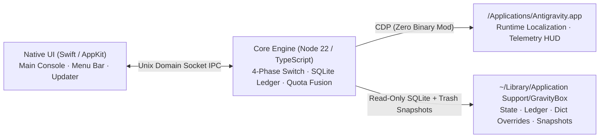

<div align="center">
  <a href="https://github.com/Enzoo404/gravitybox">
    
  </a>

  <h1>GravityBox</h1>

  <p>
    <strong>Native macOS Companion for Google Antigravity on Apple Silicon</strong><br />
    Zero App Modification · Bilingual UI (EN / 中文) · Live In-IDE Telemetry HUD · True 5h &amp; Weekly Quotas · Safe Multi-Account Switching · Reversible Cache Cleanup
  </p>

  <p>
    <a href="https://github.com/Enzoo404/gravitybox/releases/latest"></a>
    <a href="https://github.com/Enzoo404/gravitybox/actions/workflows/ci.yml"></a>
    
    <a href="./LICENSE"></a>
  </p>

  <p>
    <a href="./README.md">简体中文</a> · <b>English</b>
  </p>

  <p>
    <a href="#-what-is-gravitybox">What It Does</a> ·
    <a href="#-3-minute-quick-start">Quick Start</a> ·
    <a href="#-telemetry-hud-visual-guide">HUD Visual Guide</a> ·
    <a href="#-complete-guide-to-every-option">All Options Explained</a> ·
    <a href="#-screenshots">Screenshots</a> ·
    <a href="#-installation--upgrades">Installation</a> ·
    <a href="#-security--privacy-boundaries">Security</a> ·
    <a href="#-architecture--building-from-source">Build from Source</a>
  </p>
</div>

<br />

<div align="center">
  <picture>
    <source media="(prefers-color-scheme: dark)" srcset="assets/screenshots/hero-dark.png" />
    
  </picture>
  <sub><em>Pure macOS Swift AppKit Console &amp; Menu Bar Panel (automatically adapts to macOS Light / Dark mode)</em></sub>
</div>

---

## ✨ What Is GravityBox?

If you use Google **Antigravity** daily on macOS, you've probably hit a few blind spots: hitting rate limits without knowing whether your **5-hour rolling window** or **weekly cap** ran out, having zero visibility into live token burn or context compaction, juggling multiple Google accounts manually, or watching disk caches balloon over time.

**GravityBox** (latest `GravityBox v1.2.0`) is a lightweight native companion built to solve all of these **without modifying a single byte of official Antigravity application files**:

| Everyday Pain Point | What GravityBox Does for You |
| :--- | :--- |
| **No live feedback on speed, token burn, cache savings, or context usage** | **In-IDE Telemetry HUD**: Mounts a sleek 3-capsule bar right below every chat input showing turns, speed, tokens, cache hit rate, and context fill—expanding upward on hover or click. |
| **Confusing rate limits (mixing up 5-hour rolling windows vs. weekly caps)** | **True Dual-Window Quotas**: Separates **5-hour** and **Weekly** bars for Gemini, Claude/GPT, and standalone pools (like `Gemini 4 Argon`), with exact reset countdowns. |
| **Tedious sign-out/sign-in loops across multiple accounts** | **Safe Multi-Account Manager**: Saves multiple accounts, recommends the best standby account when quota runs low, and switches atomically after Antigravity quits—with automatic rollback if anything fails. |
| **Static language patches break official code signatures on every update** | **Zero-Patch Bilingual Adaptation**: Dynamically switches both GravityBox and Antigravity UI between **English** and **简体中文** (`2.23.0` ~ `2.33.0`) at runtime while leaving code, chats, and terminal output untouched. |
| **Gigabytes of accumulated cache with fear of deleting chat history** | **Reversible Storage Trim**: Locks your credentials and conversations behind a strict allowlist, moves selected caches to **macOS Trash**, and lets you restore with one click. |

---

## 🚀 3-Minute Quick Start

1. **Download & Install**: Grab the latest `GravityBox-<version>-arm64.dmg` from [GitHub Releases](https://github.com/Enzoo404/gravitybox/releases/latest) (self-contained runtime included—**no Node.js or external dependencies needed**), drag **GravityBox.app** into **Applications**, and run the one-line Gatekeeper command in [First-Time Installation](#first-time-installation) below.
2. **Launch & Auto-Connect**: Open **GravityBox** and launch official **Antigravity** via GravityBox (or externally). GravityBox automatically connects to Antigravity windows—attaching the live Telemetry HUD right below your chat composer and applying your chosen display language. Starting with Antigravity `2.33.0`, if Antigravity was launched externally without a remote debugging port, GravityBox surfaces a **Debug Port Not Enabled** banner to guide a safe relaunch without force-killing your workspace.
3. **Three Everyday Touchpoints**:
   - **While coding → Glance below the chat box**: Watch the live HUD capsules; hover for quick inspection or **click any capsule to pin its upward card** (press `Esc` or click outside to close).
   - **Quick checks → Click the Menu Bar icon**: Check `Usage · Quota · Accounts` anytime without leaving fullscreen, or use the top-right `···` menu to toggle HUD or switch languages.
   - **Full management → Open Main Console**: Click **Open Main Window ↗** from the menu bar footer to access **Overview · Accounts · Usage · Settings · About**.

---

## 📊 Telemetry HUD Visual Guide

The HUD sits cleanly beneath every Antigravity chat input (supporting split panes and Light/Dark themes) without overlapping controls or stealing keyboard focus.

<div align="center">
  <picture>
    <source media="(prefers-color-scheme: dark)" srcset="assets/screenshots/hud-dark.png" />
    
  </picture>
</div>

### 1. Reading the Always-On Bar (3 Capsules)

<div align="center">
  <picture>
    <source media="(prefers-color-scheme: dark)" srcset="assets/screenshots/hud-capsules-dark.png" />
    
  </picture>
</div>

```text
[ ● 3T · Turn 18s · 90 tok/s · 2 ]  │  [ ✦ 58.6M tok · Cache Hit 97% ]  │  [ ②  ━━━░░  64% ]
  └── Capsule 1: Session & Speed ──┘     └── Capsule 2: Tokens & Cache ──┘     └── Capsule 3: Context ─┘
```

| Element | What You See | What It Means |
| :--- | :--- | :--- |
| **Capsule 1 Dot** | ⚪ Gray / 🔵 Solid Blue / 💠 Breathing Blue | **Live Activity Indicator**:<br>• **Gray**: Foreground pane is idle (waiting for your prompt), paused awaiting approval, or stalled mid-run with neither the model nor local tools actively working (also remains gray when only background subagents are running while the foreground pane is inactive)<br>• **Solid Blue**: Foreground AI model is thinking or streaming text<br>• **Breathing Blue**: Foreground agent is executing tools (reading/editing files, running shell commands, searching) |
| **Capsule 1 Text** | `3T · Turn 18s · 90 tok/s` | • **`3T`**: Number of user turns in the main conversation<br>• **`Turn 18s`**: Live elapsed time for the current turn<br>• **`90 tok/s`**: Average output speed across completed model steps (`Measuring…` before first sample)<br>• **Branch icon + count (e.g. `2`)** *(when active)*: Number of background subagents currently running |
| **Capsule 2 Text** | `✦ 58.6M tok · Cache Hit 97%` | • **`58.6M tok`**: Total tokens consumed in this session (including linked subagents)<br>• **`Cache Hit 97%`**: Share of input tokens served directly from prompt cache (higher = faster & cheaper) |
| **Capsule 3 Badge** | Hidden / 🔵 `1` / 🟠 `2` / 🔴 `3+` | **Auto-Compaction Badge**:<br>• **Hidden**: No context compaction yet<br>• **Blue `1`**: Compacted once (Checkpoint)<br>• **Orange `2`**: Compacted twice<br>• **Red `3+`**: Compacted 3+ times—if the model starts forgetting early details, consider starting a fresh chat |
| **Capsule 3 Meter** | `━━━░░ 64%` (or `~64%`) | **Current Context Fill**: Percentage of the active model's context window currently used (`~` indicates a reference capacity estimate when exact limit isn't reported). Displays a short model tag during multi-model or Orchestrator sessions. |

---

### 2. Every Field in the 3 Upward Popover Cards

Hover over (or click to pin) any capsule to open its detailed breakdown card:

#### Card 1: `Session Stats` (Capsule 1)
> Header badge **`{X} turns {Y} steps`**: `X` user prompts sent in the main chat, and `Y` total thinking + tool execution steps (including linked subagents).

<div align="center">
  <picture>
    <source media="(prefers-color-scheme: dark)" srcset="assets/screenshots/hud-card-session-dark.png" />
    
  </picture>
</div>

| Field | Plain-English Meaning |
| :--- | :--- |
| **Model Duration** | Cumulative time the AI model spent thinking and generating responses in this chat. |
| **Tool Duration** | Cumulative time spent running local tools (file edits, terminal commands, searches), deduplicated across parallel tool calls. |
| **Avg TTFT** | Average **Time to First Token**—how many seconds it takes on average before the model starts responding. |
| **Output Speed (TPS)** | Session-wide output throughput (`total output tokens ÷ host generation duration`, including thinking/waiting). |
| **Turn Duration** *(below dashed line)* | Total elapsed wall-clock time for your current or most recent turn. |
| **Latest Step TTFT** | Time to first token for the single most recently completed foreground model step. |
| **Latest Step TPS** | Output speed (`tok/s`) of the single most recently completed foreground model step. |
| **Subagents** *(shown when used)* | Shows how many subagents are currently running or how many were scheduled in total (with step count). |

#### Card 2: `Token Usage` (Capsule 2)
> Header badge shows total session tokens (`K` = thousand, `M` = million, `B` = billion).

<div align="center">
  <picture>
    <source media="(prefers-color-scheme: dark)" srcset="assets/screenshots/hud-card-tokens-dark.png" />
    
  </picture>
</div>

| Field | Plain-English Meaning |
| :--- | :--- |
| **Cache Hit** | Percentage of all input tokens satisfied by prompt cache reads (e.g., `96.7%`). |
| **Uncached Input** | Fresh input tokens sent without cache reuse (new prompts, newly read files). |
| **Cached Read** | Prior context tokens reused from cache (typically billed at 10%–25% of standard input rates). |
| **Cache Write** *(shown when > 0)* | Tokens newly written into the prompt cache during this session. |
| **Output** | Total tokens generated by the model (includes both internal reasoning and visible reply). |
| **Reasoning / Reply** *(when split is recorded)* | Splits **Output** into **internal reasoning tokens** (left) vs. **visible reply tokens** (right). |
| **Estimated Cost** *(below dashed line)* | Equivalent API dollar cost calculated per step using dated official model pricing (`≥ $X` if a newly launched model has no published price yet). *Note: Subscription plans deduct quota rather than billing per token; this shows equivalent API value.* |
| **Cache Saved** | Estimated dollar amount saved thanks to prompt cache reads compared to resending uncached input every step. |

#### Card 3: `Current Context` (Capsule 3)
> Header badge shows **`Used Tokens / Model Capacity`** (e.g., `128K / 200K`) above a two-color segmented bar.

<div align="center">
  <picture>
    <source media="(prefers-color-scheme: dark)" srcset="assets/screenshots/hud-card-context-dark.png" />
    
  </picture>
</div>

| Field | Plain-English Meaning |
| :--- | :--- |
| **Cached Context** *(deep blue dot)* | Tokens in the latest request reused from prompt cache (deep blue bar segment). |
| **New Uncached Input** *(sky blue dot)* | Fresh input and tool output added in the latest step (sky blue bar segment). |
| **Latest Step Output** | Tokens just generated in the latest step (listed separately; joins context on the next turn). |
| **Session Peak Context / Model Peak Context** | Highest input context size reached so far in this chat, plus `(Xx compacted)` if auto-compaction occurred. |
| **Active Model** | Underlying model identifier for the current context reading. |
| **Orchestrator Context / Prior Model Context** *(multi-model chats)* | When switching models mid-chat or running **Planner + Executor** stages, lists each model's context fill and compaction count separately. |

---

## 🧭 Complete Guide to Every Option

### 1. Settings (`Settings`) — All 7 Controls Explained

| Section | Option | Choices / Control | What It Does & When to Use It |
| :--- | :--- | :--- | :--- |
| **Antigravity Enhancement** | **Display Language** | `Follow System` (default)<br>`简体中文`<br>`English` | **Unified language selector**: Controls both GravityBox's own UI language and whether Antigravity's UI is dynamically localized into Simplified Chinese. Selecting `English` keeps both GravityBox and Antigravity in clean English immediately—no restart needed. |
| **Antigravity Enhancement** | **Conversation HUD** | Toggle (default `On`) | Shows or hides the 3-capsule Telemetry HUD below Antigravity's chat box. **Independent of language**—you can keep Antigravity in English while enjoying the English HUD. |
| **Quota & Pricing** | **Quota Refresh Interval** | `Manual Refresh` (default)<br>`Every 5 / 10 / 15 / 30 / 60 min` | How often GravityBox polls remaining quotas for saved accounts in the background. Leave on `Manual Refresh` for single-account use, or `10–15 min` when rotating accounts. |
| **Quota & Pricing** | **Auto-Update Pricing Feed** | `Check Now` button + Toggle (default `Off`) | Syncs the public model pricing feed every 24 hours from GitHub / jsDelivr so newly launched models get accurate cost estimates without waiting for an app update.<br>Click **Check Now** to open the **Pricing Feed** sheet—inspect per-model input, cache read/write, and output rates with official source links, view newly launched unpriced models grouped cleanly by model family, and automatically heal historical unpriced entries. |
| **System & Storage** | **Launch at Login** | Toggle (default `Off`) | Starts GravityBox quietly in the macOS menu bar whenever you log in. |
| **System & Storage** | **Sync with Antigravity** | Toggle (default `Off`) | Automatically launches GravityBox when Antigravity opens and quits when Antigravity closes. |
| **System & Storage** | **Storage & Maintenance** | Status badge + `Manage Storage…` | Displays reclaimable cache size (`Reclaimable XX MB` or `Healthy`) and opens the safe cleanup sheet (see Section 5 below). |

---

### 2. Overview (`Overview`) — Daily Snapshot at a Glance
- **Active Account Quota Card**: Displays your active account, plan badge (`PRO` / `ULTRA` / `FREE`), and separate **5-Hour** vs. **Weekly** remaining bars with reset countdowns for Gemini, Claude/GPT, and standalone high-tier pools (such as `Gemini 4 Argon`). Missing or unauthorized pools are labeled honestly—never padded with fake `100%` bars.
- **Today's 3 Metric Cards**: Shows **Today's Token Usage**, **Today's Estimated Cost** (with a decoupled **`Partial`** badge when unpriced models exist, keeping the dollar figure clean), and **Today's Requests**, each paired with your all-time cumulative total.
- **24-Hour Distribution & Active Models**: Hourly consumption bar chart (`00:00–23:00`) on the left, and top active models with request share and estimated cost on the right.

---

### 3. Accounts (`Accounts`) — Multi-Account Pool & Smart Switch
- **Add Account…**:
  - **Save Current Account** *(zero setup)*: One-click import of the account currently signed in to Antigravity. To add and switch between multiple accounts, simply switch accounts in Antigravity first and import each one—no extra setup required.
- **Collapse / Expand Quotas**: Condenses multi-account cards into compact single-line summary pills (e.g., `Gemini 91%`).
- **Smart Switch (Toggle + `Configure…` button)**:
  Evaluates saved accounts and highlights a **`Recommended`** standby candidate when your current account runs low (**never force-kills Antigravity; switching always requires your confirmation**). Clicking **`Configure…`** exposes 4 rules:

  | Smart Switch Rule | What It Controls |
  | :--- | :--- |
  | **Recommendation Order** | • **`Highest Quota First`** (default): Prioritizes higher subscription tiers (Ultra > Pro), then highest remaining percentage.<br>• **`Round Robin`**: Rotates evenly across qualifying standby accounts in list order. |
  | **Monitored Scope** | Chooses which quota pool triggers a switch alert (adapts to your Free / Pro / Ultra tier): e.g., **Core Shared Pools (Gemini + Claude/GPT)**, **All Gemini (incl. Argon weekly)**, **Gemini Base Pool Only**, or **Claude/GPT Pool Only**. |
  | **Switch Trigger Threshold** | Default `10%` (`1%–98%`). Recommends switching when your monitored quota drops to or below this percentage. |
  | **Candidate Minimum** | Default `30%` (`2%–100%`, must exceed trigger threshold). Standby accounts must have at least this much quota left to be recommended. |

- **Atomic Switch & One-Click Undo**: Verifies Antigravity is closed before running a snapshot-backed switch with automatic rollback on failure. If an earlier switch was interrupted, a **Revert & Restore Previous Account** banner appears at the top.

---

### 4. Usage (`Usage`) — Historical Ledger, Request Log & Export
- **4 Time Ranges** (`Today` / `Last 7 Days` / `Last 30 Days` / `All Time`): Read-only SQLite worker scans local conversation databases in background batches without blocking the IDE.
- **API Cost Donut & Model Breakdown**: Visualizes equivalent dollar spend and token share across every model.
- **Requests & Cache + `Request Log…`**: Shows total calls, average tokens per call, and overall cache hit rate. Click **`Request Log…`** to search by model and inspect individual historical calls with exact timestamps and input / cache read / cache write / output counts.
- **Export…**: Exports aggregated summaries or detailed request logs to local `.json` files.

---

### 5. Storage & Maintenance Sheet (`Settings → Manage Storage…`)
Divides local disk usage into **Runtime Cache (Blue)**, **Background Logs (Orange)**, and **Protected Core Data (Gray, strictly untouched)**:

| Option / Button | Default | What Happens When Cleaned? |
| :--- | :--- | :--- |
| **App Runtime Cache** | `On` | Clears temporary web, V8 bytecode, GPU shader caches, and crash dumps. **Zero side effects**—rebuilt automatically as needed. |
| **Background Execution Logs** | `Off` (selectable: `Older than 7d` / `30d` / `All Inactive`) | Trims verbose background step logs, redundant transcript mirrors, and completed subagent databases from older inactive chats (archiving token usage into the permanent ledger first). **All chat messages, code files, and sign-in sessions remain 100% intact.** |
| **Clean Now** | Primary button | Moves selected caches into a recovery snapshot and **macOS Trash** (offering a graceful restart if Antigravity is running). Nothing is permanently erased behind your back. |
| **Undo Last Cleanup** | Available anytime after cleanup | Restores all items from the previous cleanup right back to their original paths in one click. |

---

### 6. Menu Bar Panel & About (`About`)
- **Menu Bar Panel**: Instant 3-tab popover (**`Usage`** with `Tokens` / `Requests` trend toggle, **`Quota`**, and **`Accounts`**) plus a top-right `···` menu for quick **Display Language**, **Conversation HUD**, **Settings (`⌘,`)**, and **Quit (`⌘Q`)** access.
- **About (`About`)**: Shows active GravityBox and Antigravity versions, reveals `~/Library/Application Support/GravityBox` in Finder, and provides **Check for Updates** / **Check Automatically** (off by default; when enabled, updates are verified via SHA-256 and offered via a gentle sidebar button rather than forced restarts).

---

## 🖼 Screenshots

> Built natively with Swift AppKit for macOS. Every preview below automatically adapts to your browser or OS Light / Dark theme.

<table>
  <tr>
    <td width="50%" align="center">
      <b>Main Console · Overview</b><br /><br />
      <picture>
        <source media="(prefers-color-scheme: dark)" srcset="assets/screenshots/dark-overview.png" />
        
      </picture>
    </td>
    <td width="50%" align="center">
      <b>Main Console · Accounts</b><br /><br />
      <picture>
        <source media="(prefers-color-scheme: dark)" srcset="assets/screenshots/dark-accounts.png" />
        
      </picture>
    </td>
  </tr>
  <tr>
    <td width="50%" align="center">
      <b>Main Console · Usage &amp; Cost</b><br /><br />
      <picture>
        <source media="(prefers-color-scheme: dark)" srcset="assets/screenshots/dark-usage.png" />
        
      </picture>
    </td>
    <td width="50%" align="center">
      <b>Main Console · Settings</b><br /><br />
      <picture>
        <source media="(prefers-color-scheme: dark)" srcset="assets/screenshots/dark-settings.png" />
        
      </picture>
    </td>
  </tr>
</table>

<details>
<summary>Show more screenshots: Menu Bar Panel tabs, Storage Maintenance sheet, and About view</summary>
<br />
<table>
  <tr>
    <td width="33.3%" align="center">
      <b>Menu Bar · Usage</b><br /><br />
      <picture>
        <source media="(prefers-color-scheme: dark)" srcset="assets/screenshots/dark-menubar.png" />
        
      </picture>
    </td>
    <td width="33.3%" align="center">
      <b>Menu Bar · Quota</b><br /><br />
      <picture>
        <source media="(prefers-color-scheme: dark)" srcset="assets/screenshots/dark-menubar-quota.png" />
        
      </picture>
    </td>
    <td width="33.3%" align="center">
      <b>Menu Bar · Accounts</b><br /><br />
      <picture>
        <source media="(prefers-color-scheme: dark)" srcset="assets/screenshots/dark-menubar-accounts.png" />
        
      </picture>
    </td>
  </tr>
  <tr>
    <td colspan="2" align="center">
      <b>Storage Trim &amp; Snapshot Restore</b><br /><br />
      <picture>
        <source media="(prefers-color-scheme: dark)" srcset="assets/screenshots/dark-maintenance.png" />
        
      </picture>
    </td>
    <td align="center">
      <b>About &amp; Updates</b><br /><br />
      <picture>
        <source media="(prefers-color-scheme: dark)" srcset="assets/screenshots/dark-about.png" />
        
      </picture>
    </td>
  </tr>
</table>
</details>

---

## 📦 Installation & Upgrades

### System Requirements
- **OS**: macOS 14 (Sonoma) or macOS 15+ (Sequoia)
- **Architecture**: Apple Silicon (`arm64` — all Apple M-series chips)
- **Target App**: Official release `/Applications/Antigravity.app` (verified across `2.23.0` ~ `2.33.0`; *Insiders channel is neither supported nor modified*)
- **Runtime**: **Zero dependencies** — self-contained Node 22 binary embedded inside the app bundle

### First-Time Installation

1. Download the latest `GravityBox-<version>-arm64.dmg` and `.sha256` checksum from [GitHub Releases](https://github.com/Enzoo404/gravitybox/releases/latest).
2. *(Recommended)* Verify DMG integrity:
   ```bash
   shasum -a 256 -c GravityBox-<version>-arm64.dmg.sha256
   ```
3. Mount the DMG and drag **GravityBox.app** into **Applications**.
4. Because open-source builds are not Apple-notarized, clear Gatekeeper quarantine once before launching:
   - **Terminal (Recommended)**:
     ```bash
     xattr -cr /Applications/GravityBox.app
     ```
   - **System Settings**: If blocked on first launch, open **System Settings → Privacy & Security** and click **Open Anyway**.

### Non-Destructive Upgrades
- **Drop-In Replacement**: Quit GravityBox and drag the new app bundle over `/Applications/GravityBox.app`. All saved accounts, custom dictionary overrides, usage ledgers, and recovery snapshots under `~/Library/Application Support/GravityBox` are preserved intact.
- **Legacy Channel Migration**: Configurations from `v1.0.5` or earlier with `applicationChannel=insiders` are automatically backed up and migrated to official `stable` mode on first launch.
- **In-App Updates**: Background update checks remain off by default; check manually or opt in anytime from the **About** tab.

<details>
<summary>Optional: Background token refresh credentials for standby accounts</summary>

Adding and switching between multiple accounts ("Save Current Account"), local quota inspection, the Telemetry HUD, SQLite cost tracking, and runtime localization require **no OAuth setup** (just switch accounts in Antigravity first and import again). Only if you want expired tokens on standby accounts to **silently refresh quotas in the background** do you need to place compatible OAuth client credentials in `~/Library/Application Support/GravityBox/.env` (works for packaged `.app` builds launched from Finder) or set them in your shell environment when running from source:

```bash
GRAVITYBOX_GOOGLE_CLIENT_ID="your-client-id.apps.googleusercontent.com"
GRAVITYBOX_GOOGLE_CLIENT_SECRET="your-client-secret"
```

</details>

---

## 🔒 Security & Privacy Boundaries

| Principle | Implementation |
| :--- | :--- |
| **Zero Telemetry** | No analytics SDKs, crash telemetry, or unprompted outbound requests; update polling is off by default |
| **Untouched Official Binary** | Never patches, unpacks, or re-signs `/Applications/Antigravity.app` |
| **Local-Only State** | Accounts, keychain references, ledgers, and snapshots live exclusively in `~/Library/Application Support/GravityBox` |
| **Protected User Content** | Input drafts, messages, code blocks, terminal logs, and project names are excluded from DOM mutation |

---

## 🛠 Architecture & Building from Source



### Build & Verification Commands

> Requires Xcode Command Line Tools and Node.js `>=22.15.0 <23`.

```bash
git clone https://github.com/Enzoo404/gravitybox.git
cd gravitybox
npm ci

# TypeScript build, pricing sync check, and unit/integration tests
npm test

# Swift native UI compilation and layout verification
npm run check:swift

# Full release verification gate (TS + tests + headless browser + Swift + dict checks)
npm run verify

# Package local Apple Silicon .app and distributable .dmg
npm run package:mac
```

<details>
<summary>Repository layout</summary>

```text
gravitybox/
├── native/          # Swift 6 / AppKit Main Console, Menu Bar Panel, L10n runtime, and App Updater
├── src/             # TypeScript core engine (IPC, bilingual i18n, 4-phase switching, quota fusion, SQLite ledger, HUD state)
├── runtime/         # CDP-injected runtime scripts (localization engine, DOM guards, and bilingual Telemetry HUD)
├── dict/ & ui-strings/ # Versioned bilingual dictionaries, frozen maps, and official UI string snapshots (2.23.0 ~ 2.33.0)
├── assets/          # App icons, bilingual packs (i18n/), Retina screenshots, dated pricing feed, and model catalog
├── test/            # Unit, integration, bilingual foundation/native tests, headless Chromium, and Swift UI suites
└── tools/           # Release integrity, privacy, doc consistency gates, screenshot generator, and macOS DMG packager
```

</details>

---

## ❓ FAQ

<details>
<summary><b>1. Why must Antigravity be closed before switching accounts?</b></summary>

Antigravity holds live SQLite and credential locks while running. Force-killing or overwriting files underneath a running IDE risks database corruption or lost drafts. GravityBox verifies a clean exit first, then runs an atomic snapshot switch with automatic rollback.

</details>

<details>
<summary><b>2. Can I use the Telemetry HUD while keeping Antigravity in English?</b></summary>

Yes! Set **Settings → Display Language** to **`English`** and keep **Conversation HUD** turned **`On`**. Antigravity stays 100% in original English while displaying the English HUD below the chat box.

</details>

<details>
<summary><b>3. What happens when Antigravity auto-updates to a newer release?</b></summary>

Because GravityBox never patches `/Applications/Antigravity.app`, official updates never break code signatures. For brand-new releases not yet fingerprinted, GravityBox enters **Adaptive Mode** using existing dictionaries while keeping quotas, account switching, HUD, and usage accounting working normally.

</details>

<details>
<summary><b>4. How do I completely uninstall GravityBox?</b></summary>

1. Quit GravityBox from the menu bar or main window (Antigravity remains untouched);
2. Move `/Applications/GravityBox.app` to the Trash;
3. Optionally delete `~/Library/Application Support/GravityBox` if you no longer want saved account metadata or usage history.

</details>

---

## 🤝 Contributing & License

- Please review [CONTRIBUTING.md](./CONTRIBUTING.md), [CODE_OF_CONDUCT.md](./CODE_OF_CONDUCT.md), and [SECURITY.md](./SECURITY.md) before opening an [Issue](https://github.com/Enzoo404/gravitybox/issues) or Pull Request.
- Full release history is available in [CHANGELOG.md](./CHANGELOG.md) and [GitHub Releases](https://github.com/Enzoo404/gravitybox/releases).

<div align="center">
  <a href="https://star-history.com/#Enzoo404/gravitybox&Date">
    
  </a>
</div>

<p align="center">
  <sub>Licensed under the <a href="./LICENSE">MIT License</a> · Third-party attributions in <a href="./THIRD_PARTY_NOTICES.md">THIRD_PARTY_NOTICES.md</a> · Not affiliated with or endorsed by Google or Antigravity.</sub>
</p>
